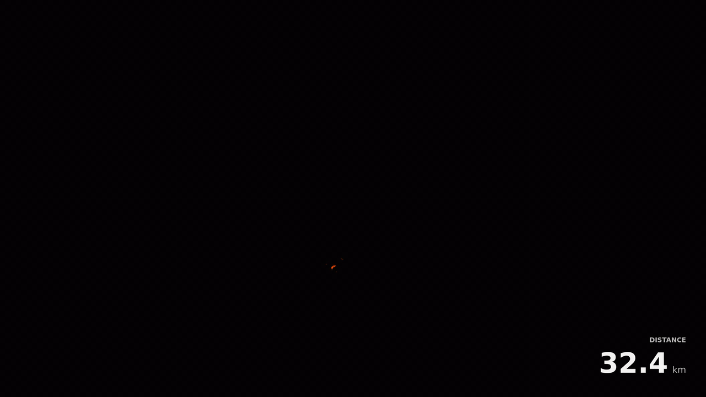
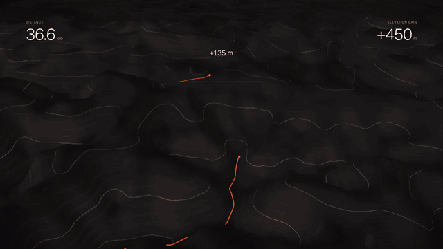
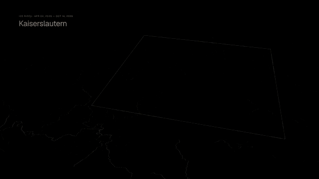
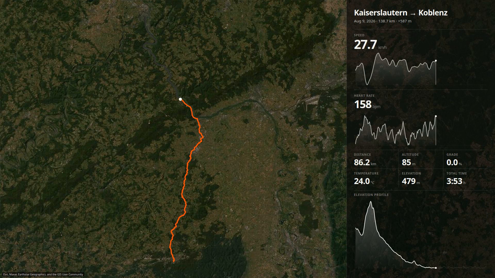
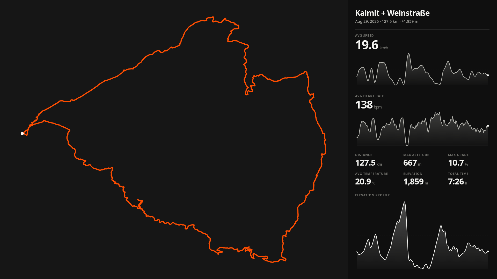
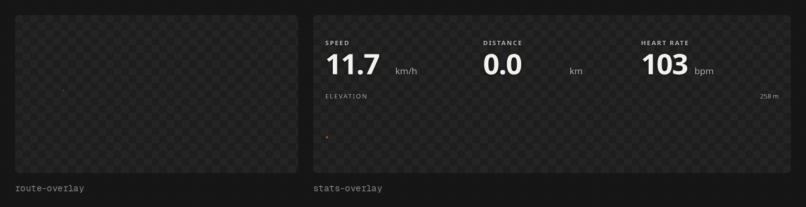

# Ride Visuals

<p align="center">
  
</p>

Ride Visuals turns cycling activity archives into maps, films, and animated
telemetry. A small tool born from a personal archive, shared for anyone who
wants to see their rides differently.

<p align="center">
  <a href="#in-3d">3D</a> ·
  <a href="#in-2d">2D</a> ·
  <a href="#overlays">Overlays</a> ·
  <a href="#what-it-makes">What it makes</a> ·
  <a href="#start">Start</a> ·
  <a href="#choose-what-to-render">Customize</a> ·
  <a href="#license">License</a>
</p>

---

## In 3D

<p align="center">
  
  <br>
  <sub>Terrain: Mapzen Terrain Tiles · Map data © OpenMapTiles © OpenStreetMap contributors</sub>
</p>

| Scene | |
| --- | --- |
| `video flyover <id>` | One ride from above, down into its climbs, ending as its own profile |
| `video strata` | A season stacked as floors, one per month or year |
| `video stretch` | A selection laid end to end along a great circle from home |
| `video territory` | Every different road ridden, each drawn once |
| `video ascent` | The roads bend up off the map to the height they climbed, beside landmarks at true scale |

```bash
make preview-flyover ACTIVITY_ID=<activity-id>
ride-visuals video strata --year 2026 --period month
ride-visuals video stretch --year 2026 --look satellite
ride-visuals video territory --year 2026 --aspect 9:16
ride-visuals video ascent --start-date 2022-01-01 --end-date 2025-12-31
```

---

## In 2D

<p align="center">
  
</p>

| Video | |
| --- | --- |
| `video collection` | A season accumulating on a map, as in the header |
| `video telemetry <id>` | One ride with live speed, heart rate, elevation, grade, and temperature |

```bash
make preview-collection MOTION=elapsed STYLE=density MINIMAL=1 SCOPE="--year 2026"
make preview-activity ACTIVITY_ID=<activity-id> TELEMETRY_BASEMAP=satellite
```

---

## Overlays

<p align="center">
  
  
</p>

| Video | |
| --- | --- |
| `video overlay <id>` | Route and summary as a transparent PNG, alpha WebM, or ProRes 4444 MOV |
| `video route-overlay <id>`, `video stats-overlay <id>` | The same as two separate layers for an editing timeline |
| `video telemetry <id> --background-image` | Telemetry over your own photo or clip (`--background-video`) |

```bash
ride-visuals video overlay <activity-id> --overlay-format png --aspect 16:9
ride-visuals video route-overlay <activity-id> --overlay-format mov
ride-visuals video stats-overlay <activity-id> --aspect 16:9 --overlay-format mov
ride-visuals video telemetry <activity-id> --background-image photo.jpg --aspect 9:16
```

---

## What it makes

| Output | Commands | Destination |
| --- | --- | --- |
| **Maps** | `map overview`, `map heatmap`, `map effort` (300 DPI) | `outputs/maps/` |
| **Collection videos** | `video collection`, `video progress`, `video timeline` | `outputs/videos/` |
| **3D scenes** | `video flyover`, `video stretch`, `video strata`, `video territory`, `video ascent` | `outputs/videos/` |
| **Activity renders** | `video telemetry`, `video minimal`, `video clean`, `video overlay`, `video route-overlay`, `video stats-overlay` | `outputs/videos/` |
| **Reports** | `report progress`, `report dashboard`, `report timeline` | `outputs/reports/` |

---

## Start

### 1. Install

Requires Python 3.11+, FFmpeg, Node.js, and npm.

```bash
python -m venv .venv
source .venv/bin/activate
pip install -e '.[dev]'
npm --prefix renderer ci --no-bin-links
cp config/config.example.toml config/config.toml
```

### 2. Add your rides

- **GPS files (`.fit`, `.tcx`, `.gpx`, also `.gz`)**: drop them in
  `bulk_download/`, or import one:
  ```bash
  ride-visuals ingest-fit ~/Downloads/Kalmit_Weinstraße.fit
  ```
- **Strava**: request your
  [bulk export](https://support.strava.com/en-us/articles/15401919-exporting-your-data-and-bulk-export)
  and place `activities.csv` and `activities/` in `bulk_download/` (English,
  Portuguese, Spanish, French, German, Italian, or Dutch).

### 3. Render

The full collection (catalog, reports, maps, and 16:9 + 9:16 videos):

```bash
make --jobs=6 final
```

One activity:

```bash
make final-activity ACTIVITY_ID=<activity-id>
```

---

## Choose what to render

Set defaults in `config/config.toml` or pass flags. Add `--preview` for a short
draft first.

- **Period**: filter inclusively with `--start-date`, `--end-date`, `--year`,
  and `--month`. Rebuild the catalog from scratch with
  `ride-visuals ingest --clean --all`.
  ```bash
  make preview-collection SCOPE="--year 2025 --month 4"
  make final SCOPE="--start-date 2024-02-01 --end-date 2024-12-31"
  ```
- **Collection layout**: pass `--minimal` for a map-first canvas showing only
  accumulated distance, or `--clean` to hide the panel. Add `--cursors`,
  `--legend`, or `--background-tracks` for additional context.
  ```bash
  ride-visuals video collection --motion elapsed --style altitude --basemap topo
  ```
- **Canvas, language, and theme**: render in `16:9`, `9:16`, `4k` (3840×2160),
  or `instagram` (1080×1920 Story with safe-area margins). Choose `--locale en`
  or `--locale pt-BR`, and `--theme midnight` or `--theme frost`.
- **3D look and scenes**: `--look carbon` (default) is a near-black map with
  relief shading and contour lines; `--look satellite` mixes in Esri imagery.
  Choose `--period month` or `--period year` for `video strata`, `--toward
  <place|lat,lon>` to aim `video stretch` at a destination, and `--title` to
  set a custom opening headline. `--highlight` adds a closing line when a
  flyover ride stands out; `--stills 4,22.5` renders just those seconds as PNGs.
- **Credits**: every output gets a `<name>.credits.txt` listing its sources and
  licenses; `--credits-on-screen` also draws a short attribution line.

Run `ride-visuals --help` for all commands and options.

## Development

```bash
make check
```

`make check` runs diagnostics, linting, tests, and typechecking. For a 3D scene
in Remotion Studio, run `ride-visuals tiles serve --spec
outputs/render-specs/<scene>.json` and open `Scene3D` with `specUrl` set to
`http://127.0.0.1:8790/files/latest.json`. Showcase assets come from
`showcase/generate.sh` ([details](showcase/README.md)).

## License

Copyright (C) 2026 Henrique Lindemann

Ride Visuals is licensed under `AGPL-3.0-only`. The renderer has a narrow
compatibility exception for Remotion; see [LICENSE_EXCEPTION](LICENSE_EXCEPTION).
Remotion remains under its own license. Other credits and terms are listed in
[THIRD_PARTY.md](THIRD_PARTY.md).

---

> *“For all its material advantages, the sedentary life has left us edgy, unfulfilled. Even after 400 generations in villages and cities, we haven’t forgotten. The open road still softly calls, like a nearly forgotten song of childhood. We invest far-off places with a certain romance. This appeal, I suspect, has been meticulously crafted by natural selection as an essential element in our survival.”*
>
> — Carl Sagan
