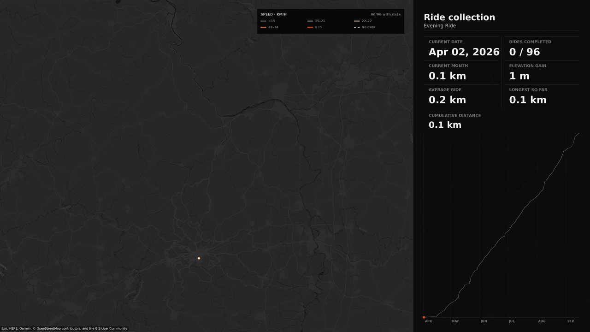
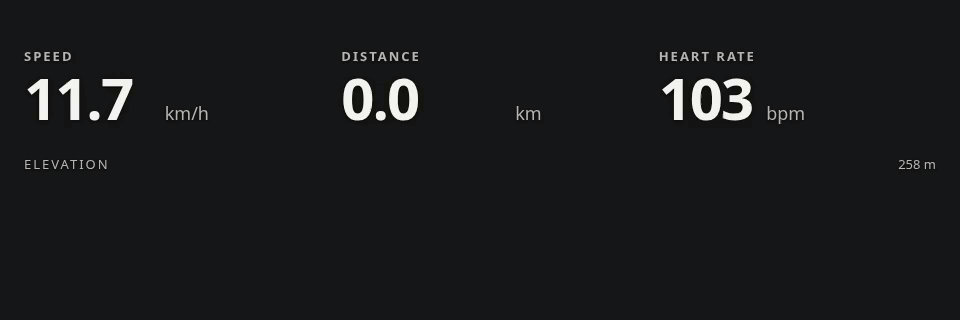
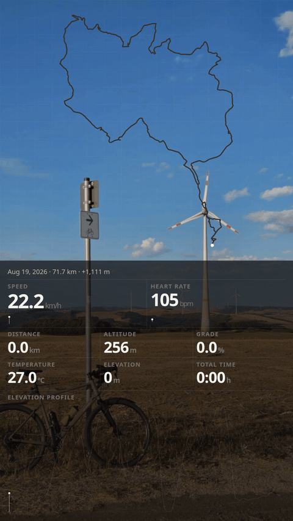

# Ride Visuals

<p align="center">
  
</p>

Ride Visuals turns cycling activity archives into maps, reports, and animated
telemetry. It is a small tool born from a personal archive and shared for anyone
who wants to see their rides differently.

<p align="center">
  <a href="#a-collection-over-time">Collection</a> ·
  <a href="#one-ride-in-detail">One ride</a> ·
  <a href="#overlays-and-media">Overlays</a> ·
  <a href="#in-3d">3D</a> ·
  <a href="#what-it-makes">What it makes</a> ·
  <a href="#start">Start</a> ·
  <a href="#choose-what-to-render">Customize</a> ·
  <a href="#license">License</a>
</p>

---

## A collection over time

<p align="center">
  
</p>

Routes accumulate in **chronological**, **simultaneous** (`elapsed`, aligning
starts while keeping each ride's real duration), or **comet** motion. Color
tracks by density, speed, heart rate, altitude, grade, temperature, or month
over plain, dark, satellite, topographic, or OpenStreetMap basemaps.

```bash
make preview-collection MOTION=chronological STYLE=speed \
  VIDEO_BASEMAP=dark SCOPE="--start-date 2026-02-08"
```

---

## One ride in detail

<p align="center">
  
</p>

The activity view follows route progress alongside live speed, heart rate,
elevation profile, grade, temperature, and distance.

```bash
make preview-activity ACTIVITY_ID=<activity-id> TELEMETRY_BASEMAP=satellite
```

---

## Overlays and media

### Transparent route and summary

<p align="center">
  
</p>

Export the route and summary as a transparent PNG, alpha WebM, or ProRes 4444
MOV for external layouts and editing timelines:

```bash
ride-visuals video overlay <activity-id> --overlay-format png --aspect 16:9
```

### Separate route and statistics layers

<p align="center">
  
</p>

Render the route trace and the telemetry strip as independent alpha layers and
align their first frames in your video editor:

```bash
ride-visuals video route-overlay <activity-id> --overlay-format mov
ride-visuals video stats-overlay <activity-id> --aspect 16:9 --overlay-format mov
```

### Telemetry over photos or video

<p align="center">
  
</p>

Composite moving telemetry directly over a photo or video clip (preserving its
audio unless `--no-background-video-audio` is passed):

```bash
ride-visuals video telemetry <activity-id> --background-image photo.jpg \
  --background-blur 0 --background-dim 0.18 --aspect 9:16 --title ""

ride-visuals video telemetry <activity-id> --background-video clip.mp4 \
  --background-dim 0.2 --aspect instagram
```

---

## In 3D

Three cinematic scenes render real terrain with MapLibre GL inside Remotion.
Tiles are fetched on demand and cached under `data/cache/tiles/`, so the same
commands work for rides anywhere in the world (relief is ~30 m globally, finer
where national elevation models exist).

- **`video flyover <id>`**: one ride from above, then down into the relief.
  The chase camera reads ahead along the route, the relief is exaggerated to
  the scale of the view and swells over the featured climbs, and the hardest
  climb is shown from the side. At the end the camera comes down level beside
  the ride and the route straightens into its own elevation profile.
- **`video stretch`**: every ride of a selection laid end to end along a great
  circle from home, out onto the globe: each ride is used up along its own road
  while the line grows by the same distance (eastward, or `--toward "Lisbon"` /
  `--toward "38.72,-9.14"` to aim at a place).
- **`video strata`**: rides stacked as floors by month or year
  (`--period auto|month|year`) over the home region.

```bash
make preview-flyover ACTIVITY_ID=<activity-id>
ride-visuals video stretch --year 2026 --look satellite
ride-visuals video strata --year 2026 --period month --aspect 9:16
```

`--look carbon` (default) is a near-black map with relief shading and contour
lines; `--look satellite` mixes in Esri imagery. 3D renders are slow (a 30 s
preview takes several minutes); `--aspect 4k` renders 1920×1080 at scale 2.
To work on a scene in Remotion Studio, run `ride-visuals tiles serve --spec
outputs/render-specs/<scene>.json` and open the `Scene3D` composition with
`specUrl` set to `http://127.0.0.1:8790/files/latest.json`.

---

## What it makes

| Output | Commands | Destination |
| --- | --- | --- |
| **Maps** | `map overview`, `map heatmap`, `map effort` (300 DPI) | `outputs/maps/` |
| **Collection videos** | `video collection`, `video progress`, `video timeline` | `outputs/videos/` |
| **3D scenes** | `video flyover`, `video stretch`, `video strata` | `outputs/videos/` |
| **Activity renders** | `video telemetry`, `video minimal`, `video clean`, `video overlay`, `video route-overlay`, `video stats-overlay` | `outputs/videos/` |
| **Reports** | `report progress`, `report dashboard`, `report timeline` | `outputs/reports/` |

The project as a whole is an active work in progress, and the reporting views in
particular are still in early shape.

---

## Start

### 1. Install

Requires Python 3.11+, FFmpeg, Node.js, and npm.

```bash
python -m venv .venv
source .venv/bin/activate
pip install -e '.[dev]'
npm --prefix renderer ci --no-bin-links
cp config/config.example.toml config/config.toml
```

### 2. Add your rides

Ride Visuals works with standalone GPS files or with a Strava archive:

- **Without Strava (`.fit`, `.tcx`, `.gpx`)**: place your activity files
  directly inside `bulk_download/` (compressed `.gz` files are supported), or
  import individual files into the collection:
  ```bash
  ride-visuals ingest-fit ~/Downloads/Kalmit_Weinstraße.fit
  ```
- **From a Strava bulk export**: request your archive via
  [Exporting Your Data and Bulk Export](https://support.strava.com/en-us/articles/15401919-exporting-your-data-and-bulk-export)
  and place `activities.csv` and `activities/` under `bulk_download/`. Exports
  in English, Portuguese, Spanish, French, German, Italian, and Dutch are
  recognized out of the box.

### 3. Render

Generate the full collection (catalog ingestion, reports, maps, and 16:9 + 9:16
collection videos):

```bash
make --jobs=6 final
```

Render a single activity by its ID:

```bash
make final-activity ACTIVITY_ID=<activity-id>
```

---

## Choose what to render

Set defaults in `config/config.toml` or pass flags on the command line. Add
`--preview` to render a short draft before committing to a full render.

- **Period**: filter inclusively with `--start-date`, `--end-date`, `--year`,
  and `--month`. Rebuild the catalog from scratch with
  `ride-visuals ingest --clean --all`.
  ```bash
  make preview-collection SCOPE="--year 2025 --month 4"
  make final SCOPE="--start-date 2024-02-01 --end-date 2024-12-31"
  ```
- **Collection layout**: pass `--minimal` for a map-first canvas showing only
  accumulated distance, or `--clean` to hide the panel. Add `--cursors`,
  `--legend`, or `--background-tracks` for additional context.
  ```bash
  ride-visuals video collection --motion elapsed --style altitude --basemap topo
  ```
- **Canvas, language, and theme**: render in `16:9`, `9:16`, `4k` (3840×2160),
  or `instagram` (1080×1920 Story with safe-area margins). Choose `--locale en`
  or `--locale pt-BR`, and `--theme midnight` or `--theme frost`.

- **Credits for publishing**: every map and video gets a
  `<name>.credits.txt` next to it that lists the map, terrain, imagery, and
  place-name sources with their licenses, ready to paste into a video
  description. Frames stay clean by default; pass `--credits-on-screen` to
  also draw a short attribution line.

Run `ride-visuals --help` for all commands and options.

## Development

```bash
make check
```

`make check` runs environment diagnostics, linting, Python and renderer tests,
and typechecking. The showcase assets are regenerated by `showcase/generate.sh`;
see [showcase/README.md](showcase/README.md).

## License

Copyright (C) 2026 Henrique Lindemann

Ride Visuals is licensed under `AGPL-3.0-only`. The renderer has a narrow
compatibility exception for Remotion; see [LICENSE_EXCEPTION](LICENSE_EXCEPTION).
Remotion remains under its own license. Other credits and terms are listed in
[THIRD_PARTY.md](THIRD_PARTY.md).

---

> *“For all its material advantages, the sedentary life has left us edgy, unfulfilled. Even after 400 generations in villages and cities, we haven’t forgotten. The open road still softly calls, like a nearly forgotten song of childhood. We invest far-off places with a certain romance. This appeal, I suspect, has been meticulously crafted by natural selection as an essential element in our survival.”*
>
> — Carl Sagan
